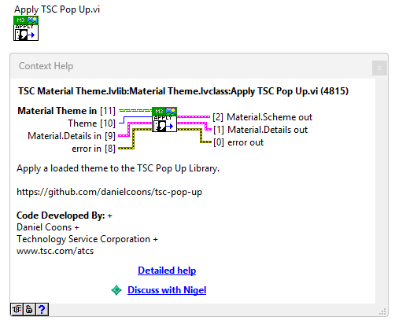

# Apply a theme in code

Two main VIs apply the theme to a given VI.

## Load Material Theme.vi

Provide the **file path** of the theme file (`.json` extension) to load the theme object into the application.

This VI returns the `Theme` object that can be used throughout the application.

## Apply UI Theme.vi

This VI is what is used to apply the theme object properties to the UI elements for an application. This can be called with multiple VIs to apply the theme across all dialogs and user views.

### Inputs

- **VI Refnum**: Reference to the VI to update.
- **Material Theme in**: Theme object
- Theme Mode: Dark Theme, Light Theme, etc.
- save? (Default TRUE): Boolean to choose whether to save the VI (saving errors will occur in PPLs and EXEs but will be cleared by the tool)
- close ref? (Default TRUE): will close the reference to the VI input (in some cases it makes sense to keep the reference open if it is being used for other things)

### Outputs

- Duplicate of the Material Theme out

💎The following VI is special case use for when you are also using the TSC Pop-Up Library [VIPM](https://www.vipm.io/package/tsc_lib_tsc_pop_up/)

## Apply TSC Pop Up.vi

Use the material theme to apply to the rules of the TSC Pop Up Library

### Inputs

- **Material Theme in**: Theme object
- Theme : Dark Theme, Light Theme, etc.
- Materials.Details in : cluster to define:

  - Font Name
  - Button Font Size
  - Message Font Size
  - Message Text Justification
  - Picture Background (color)

### Outputs

- Material.Scheme out : cluster of the Scheme information to apply to the Pop Up tools
- Materials.Details out : duplicate output of the details cluster

