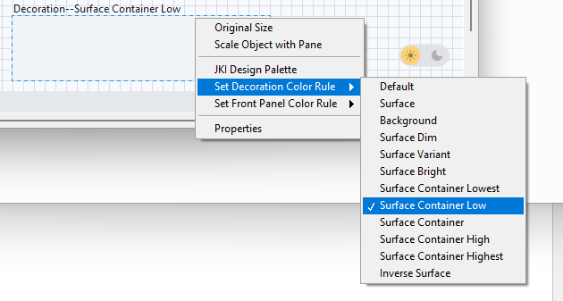
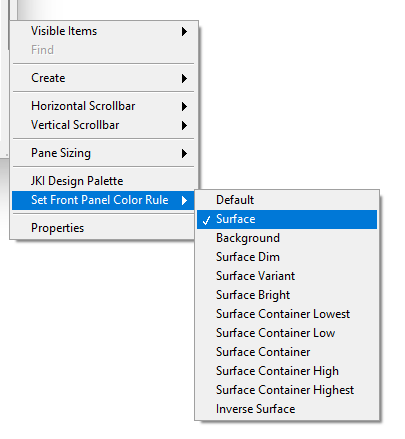

# Edit-time menus

Automatic coloring uses color rules set on a control, indicator, panel or decoration via `Right-click`. You can apply these broadly with [Edit VI Theme](/material-theme/edit-vi-theme/) or through right-click menus.  

✨ All data is saved in the **tag** data of the control.

> Right-clicking a Boolean control also lets you change the Boolean image(s) and image color.
>
> Save the VI after setting any of these options.

## Control color rule

## Button description of type

Defines the **Boolean type level**, which is how coloring decisions are made.

## Tab control rules

## Decoration rules

## Front panel rules

