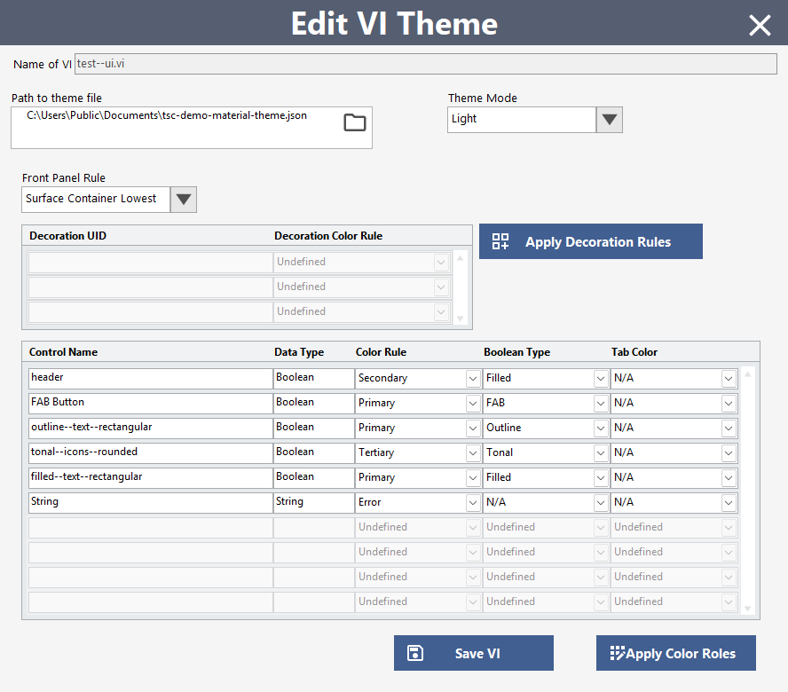

# Edit VI Theme

Launch the editor for a given VI by going to `Tools → TSC → Edit VI Theme...`  

✨ Available through Quick Drop, `Ctrl+C` by default  

Select the coloring rules for:

- Front panel
- Decorations
- All controls and indicators
  - Color Rule
  - Boolean Type (if applicable)
  - Tab Color (if applicable)

> **Save the VI to keep the metadata of the theme file and theme mode.**

